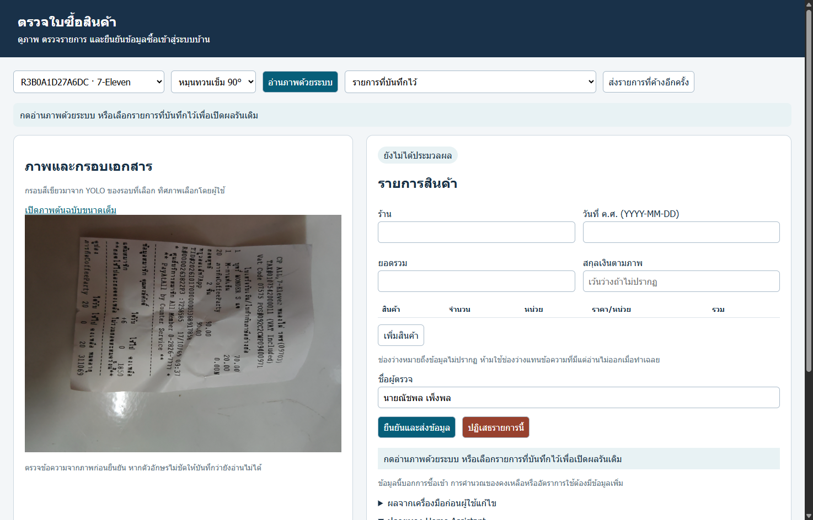
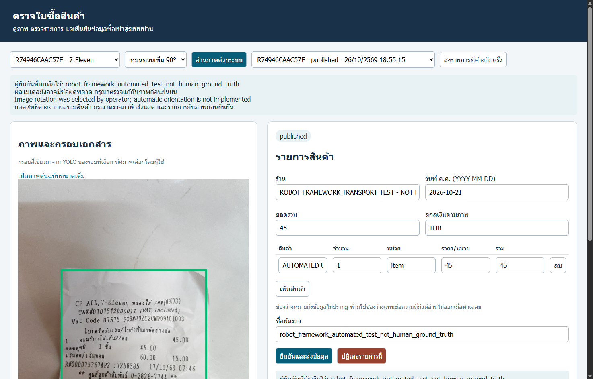
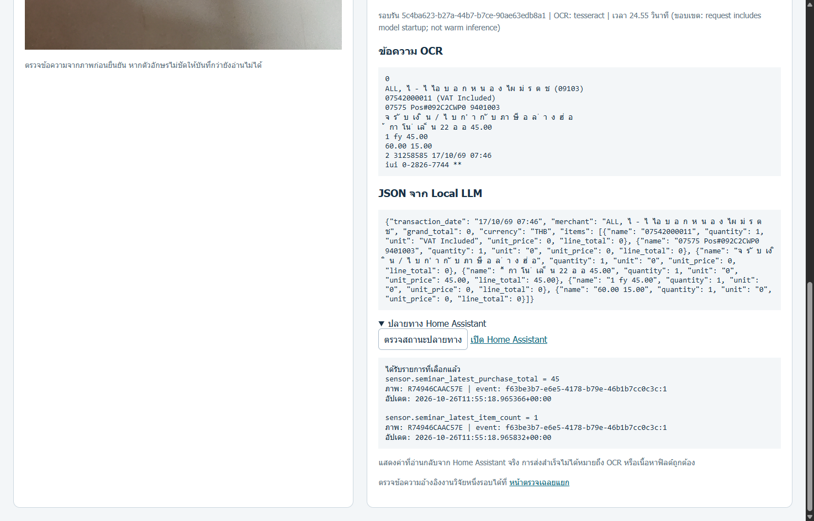
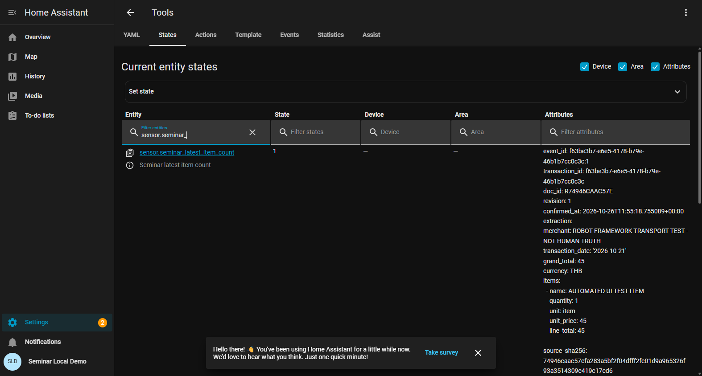

# คู่มือกดตามทีละขั้น — เปิดเดโม ซ้อม และพรี 10 นาที

คู่มือสำหรับณัชพลและธนบดี • ตรวจชื่อปุ่มจากระบบรุ่นปัจจุบัน 26 ตุลาคม 2569

**แผนล่าสุด: อัดคลิปที่กดอ่านภาพด้วยระบบจริง → ตรวจแก้ → ยืนยัน → ดู Home Assistant แล้วเปิดคลิปตอนพรี** ใช้ [บทอัดคลิปทีละช็อต](RECORD_DEMO_SCRIPT.html) เป็นโพยหน้าเครื่อง ผลย้อนหลังเป็นแผนสำรองเท่านั้น

**เริ่มใช้: เปิด `CLICK_BY_CLICK_GUIDE.html` ด้วย Chrome หรือ Edge** มีสารบัญกดข้ามหัวข้อและภาพประกอบ เปิดอ่านได้แม้ยังไม่เปิดบริการเดโม ส่วนเว็บเดโมต้องใช้เครื่องที่ติดตั้งระบบไว้แล้ว

## 1. เตรียมไฟล์และเลือกทางที่จะพรี

เปิดโฟลเดอร์ `Seminar` แล้วเข้า `PRESENTATION_READY_2026-10-26` ใช้ไฟล์เหล่านี้:

| ใช้ทำอะไร | ไฟล์ที่เปิด |
|---|---|
| ฉายสไลด์ | [Ass5_10MIN_RECORDED_DEMO_v3_2026-10-26.pptx](Ass5_10MIN_RECORDED_DEMO_v3_2026-10-26.pptx) |
| สำรองเมื่อ PowerPoint มีปัญหา | [PDF ชุดเดียวกัน](Ass5_10MIN_RECORDED_DEMO_v3_2026-10-26.pdf) |
| ซ้อมคำพูด | [SCRIPT_10_MIN_REVIEWED_v3.md](SCRIPT_10_MIN_REVIEWED_v3.md) |
| เตรียมตอบกรรมการ | [QA_ALL_21_SLIDES.md](QA_ALL_21_SLIDES.md) |
| เปิดบริการเดโม | `Seminar\DEMO_PRESENTATION_2026-10-21\OPEN_DEMO.cmd` |

**สำหรับการลองครั้งแรก ให้ทำหัวข้อ 2 → 3 → 4 → 5 → 6 ก่อน ยังไม่ต้องจับเวลา 2 นาที** เมื่อเข้าใจแล้วจึงเลือกวิธีขึ้นพรีในหัวข้อ 7 และซ้อมตามหัวข้อ 8

- ถ้าจะทำข้อมูลที่คนตรวจจริง: ทำหัวข้อ 4–6 โดยอ่านใบซื้อสินค้าด้วยตนเอง แล้วเก็บ URL ของรายการนั้นไว้
- ถ้าต้องการดูระบบทันทีโดยไม่รอโมเดล: ทำหัวข้อ 3 ใช้ผล Robot ที่บันทึกไว้ และบอกว่าเป็นข้อมูลทดสอบการส่ง
- **ทางหลักที่เลือกแล้ว:** ทำหัวข้อ 4–6 ระหว่างอัดคลิป แล้วตัดต่อไม่เกิน 2 นาทีตาม [บทอัดคลิป](RECORD_DEMO_SCRIPT.html) ปัจจุบันยังต้องอัดไฟล์ `DEMO_2_MIN.mp4` จริง

เครื่องเพื่อนที่มีเพียงไฟล์จาก GitHub เปิดสไลด์และคู่มือนี้ได้ แต่ยังเปิดบริการเดโมไม่ได้จนกว่าจะมี Python, โมเดล, WSL และบริการที่ตั้งค่าไว้ `127.0.0.1` หมายถึงเครื่องที่กำลังเปิดเบราว์เซอร์อยู่

## 2. เปิดระบบตั้งแต่เริ่ม

1. เสียบสายชาร์จ ใช้เครื่องที่ติดตั้งเดโมไว้ ปิดหน้าต่างหรือการแจ้งเตือนส่วนตัวที่ไม่ต้องการฉาย
2. กด **Windows + E** เพื่อเปิด File Explorer
3. เข้าโฟลเดอร์ `Seminar` → `DEMO_PRESENTATION_2026-10-21`
4. ดับเบิลคลิก **OPEN_DEMO.cmd** ไม่ใช่ `Start-Demo.ps1` หาก Windows ซ่อนนามสกุล ชื่ออาจแสดงเป็น `OPEN_DEMO`
5. รอให้สคริปต์ตรวจ runtime และเปิด MQTT / Home Assistant อย่ากดเปิดซ้ำหลายหน้าต่าง
6. ถ้าสำเร็จ จะมีข้อความ **SERVICES READY: http://127.0.0.1:8090/demo** และเปิดเบราว์เซอร์ หน้าต่างคำสั่งอาจปิดเองเมื่อทำงานเสร็จ
7. ถ้าเบราว์เซอร์ไม่เปิด ให้เปิด Chrome หรือ Edge กด **Ctrl + L** พิมพ์ `http://127.0.0.1:8090/demo` แล้วกด **Enter** เรียกแท็บนี้ว่า **แท็บ A**
8. กด **Ctrl + T** แล้วเปิด `http://127.0.0.1:8123/config/tools/state` เรียกแท็บนี้ว่า **แท็บ B**
9. ถ้าแท็บ B ขอเข้าสู่ระบบ ให้ใช้บัญชี Home Assistant ของเครื่องนี้ หากเข้าอยู่แล้วให้ข้าม ไม่ต้องสร้างบัญชีใหม่ หากจำไม่ได้ ข้อมูลตั้งค่าบัญชีอยู่ในไฟล์ส่วนตัว `C:\Users\NATCHAPOL\SeminarLab\preboard\services\ha_auth.json` เปิดตรวจเฉพาะก่อนแชร์จอ ปิดไฟล์ก่อนอัดหรือพรี และอย่านำไฟล์นี้ไปส่งให้เพื่อน
10. กลับแท็บ A ตรวจว่าเห็นหัวข้อ **ตรวจใบซื้อสินค้า**, ภาพทางซ้าย และฟอร์มทางขวา หากหน้าจอแคบ ฟอร์มจะอยู่ถัดลงมาด้านล่าง ให้เลื่อนลง

**สิ่งที่ขั้นนี้ยืนยัน:** เปิดบริการและเชื่อมต่อได้ การขึ้น SERVICES READY ยังไม่ยืนยันว่าโมเดลอ่านข้อความใหม่สำเร็จ ต้องทำหัวข้อ 4 เพิ่มก่อนใช้เดโมสด



ภาพหน้าเริ่มต้นที่เปิดตรวจจริง เมนูและช่องกรอกอาจเรียงต่างกันตามความกว้างหน้าต่าง

## 3. ลองเปิดผลย้อนหลังทันที — ไม่ต้องรอโมเดล

ขั้นนี้เหมาะสำหรับทำความคุ้นเคยกับหน้าจอ และเป็นเส้นทางสำรองในวันพรี

1. ที่แท็บ A กด **Ctrl + L**
2. วาง URL นี้ แล้วกด **Enter**:

   [เปิดผลทดสอบ Robot ที่บันทึกไว้](http://127.0.0.1:8090/demo?receipt=f63be3b7-e6e5-4178-b79e-46b1b7cc0c3c)

   `http://127.0.0.1:8090/demo?receipt=f63be3b7-e6e5-4178-b79e-46b1b7cc0c3c`

3. รอให้ภาพขึ้นครบ ควรเห็นกรอบสีเขียวและสถานะ `published` ช่องร้านมีข้อความ `ROBOT FRAMEWORK TRANSPORT TEST - NOT HUMAN TRUTH` และชื่อผู้ตรวจเป็น `robot_framework_automated_test_not_human_ground_truth`
4. เลื่อนลง แล้วคลิกข้อความ **ผลจากเครื่องมือก่อนผู้ใช้แก้ไข** เพื่อกางส่วนผลดิบ ดู **ข้อความ OCR**, **JSON จาก Local LLM** และ **รอบรัน**
5. เลื่อนลงถึงหัวข้อ **ปลายทาง Home Assistant** กด **ตรวจสถานะปลายทาง**
6. ถ้าขึ้น **ได้รับรายการที่เลือกแล้ว** ให้ดูว่ามี sensor สองตัวและ event เดียวกัน หากขึ้น **ค่าล่าสุดยังไม่ตรงรายการที่เลือก** หมายถึง HA แสดงรายการอื่นที่ส่งภายหลัง ให้เปิดเผยตามนั้น ไม่กดยืนยันใหม่เพื่อทำให้ภาพดูตรง

**คำพูดสำหรับรายการนี้:** “นี่เป็นผลย้อนหลังจากการทดสอบ Robot ครับ ภาพและผลโมเดลมาจากระบบ ส่วนชื่อสินค้าและข้อมูลที่ส่งเป็นค่าทดสอบการเชื่อมต่อ ยังไม่ใช่รายการที่เจ้าของงานตรวจความถูกต้องแล้วครับ”

ยอด `45`, จำนวนแถวสินค้า `1` และวันที่ `2026-10-21` ในฟอร์มนี้เป็นค่าที่ Robot ป้อนทดสอบ อย่าคัดลอกมาเป็นคำตอบของใบซื้อสินค้าโดยไม่อ่านภาพ **ขั้นนี้ไม่ต้องกดอ่านภาพ ยืนยัน ปฏิเสธ หรือส่งซ้ำ**



ภาพนี้เป็นผลทดสอบสังเคราะห์สำหรับตรวจการส่ง ไม่ใช่ตัวอย่างที่คนตรวจยืนยันความถูกต้องแล้ว

## 4. ซ้อมอ่านภาพใหม่ทีละคลิก

ทำก่อนวันพรีหรือก่อนอัดคลิป เผื่อเวลารอหลายนาทีบน CPU ไม่ใช้เวลานี้เป็นส่วนบังคับของเดโม 2 นาที

1. เปิดแท็บ A กด **Ctrl + L** เข้า `http://127.0.0.1:8090/demo` ใหม่ เพื่อเริ่มจากหน้าที่ไม่ได้เลือกรายการย้อนหลัง
2. คลิกเมนูซ้ายสุดบนหน้าเว็บ ซึ่งแสดงรหัสภาพและชื่อร้าน เลือก **R74946CAAC57E** รายการอาจมีชื่อร้านต่อท้าย
3. ดูภาพด้านซ้าย แล้วตรวจเมนูทิศภาพที่อยู่ถัดมา สำหรับภาพนี้เลือก **หมุนทวนเข็ม 90°** เมนูอาจเลือกให้อยู่แล้ว ค่านี้ใช้ตอนประมวลผล ไม่ได้หมายความว่าภาพต้นฉบับที่เห็นจะหมุนทันที
4. คลิก **อ่านภาพด้วยระบบ** หนึ่งครั้ง ปุ่มจะจางลง และมีข้อความ **กำลังตรวจภาพและอ่านรายการ อาจใช้เวลาหลายนาทีบน CPU…** ระหว่างรออย่ารีเฟรชหรือเปลี่ยนรายการ
5. เมื่อเสร็จ ปุ่มจะกลับมากดได้ ภาพควรโหลดครบและมีกรอบสีเขียว ฟอร์มมีผลที่ระบบอ่าน และสถานะมักเป็น `pending_review` ซึ่งหมายถึงรอคนตรวจ
6. อ่านข้อความแจ้งเตือนด้านบน ถ้ามี error หรือบอกว่าโมเดลล้มเหลว อย่าใช้สถานะ pending_review เป็นหลักฐานว่า LLM สำเร็จ
7. เลื่อนลงแล้วคลิก **ผลจากเครื่องมือก่อนผู้ใช้แก้ไข** ตรวจว่า OCR มีข้อความ และส่วน JSON มีโครงสร้างข้อมูล เช่น `items` พร้อมรหัสรอบรัน หากผลว่างหรือมี error ให้ดูหัวข้อ 10
8. เก็บ URL ของรอบนี้: กลับด้านบน คลิกเมนู **รายการที่บันทึกไว้** รายการที่ถูกเลือกคือรอบที่เพิ่งอ่าน ถ้าต้องการคัดลอก receipt ID จากหน้าจอ ให้ทำหลังยืนยันในหัวข้อ 5 ซึ่งข้อความจะแสดง event ID ชัดเจน URL หน้าเว็บไม่ได้เปลี่ยนเป็นลิงก์รอบใหม่ให้อัตโนมัติ

**คำพูดประกอบ:** “ผมเลือกทิศของภาพเอง จากนั้น YOLO หาตำแหน่งเอกสาร OCR อ่านข้อความ แล้ว Local LLM จัดเป็น JSON ครับ ผลนี้ยังต้องตรวจแก้ก่อนนำไปใช้”

หน้าเดโมปัจจุบันใช้ภาพจากชุดที่เตรียมไว้ ไม่มีปุ่ม Upload หรือ Browse สำหรับเพิ่มภาพใหม่จากเครื่อง

## 5. ตรวจแก้ฟอร์ม และยืนยันด้วยชื่อของผู้ตรวจจริง

1. คลิก **เปิดภาพต้นฉบับขนาดเต็ม** ทางซ้าย ระบบเปิดภาพในแท็บใหม่ ใช้ดูข้อความที่เล็กแล้วกลับแท็บ A อย่าเดาคำที่มองไม่ออก
2. ช่อง **ร้าน**: คลิกในช่อง กด **Ctrl + A** แล้วพิมพ์ชื่อที่อ่านได้จากภาพ
3. ช่อง **วันที่ ค.ศ. (YYYY-MM-DD)**: อ่านวันที่บนใบซื้อสินค้าแล้วกรอกเป็นปี-เดือน-วัน เช่น `2026-10-17` เป็นเพียงตัวอย่างรูปแบบ ถ้าเป็น พ.ศ. ให้ลบ 543 หลังตรวจว่าปีถูกต้อง ไม่ใช้วันปัจจุบันหรือวันทดสอบแทนวันที่ซื้อ
4. ช่อง **ยอดรวม**: กรอกยอดซื้อสุทธิจากภาพ แยกจากเงินรับและเงินทอน ไม่พิมพ์เครื่องหมายสกุลเงินในช่องตัวเลข
5. ช่อง **สกุลเงินตามภาพ**: กรอกเมื่อมีหลักฐานจากภาพ หากไม่ปรากฏให้เว้นว่าง
6. ตรวจตารางทีละแถว คอลัมน์เรียงเป็น **สินค้า → จำนวน → หน่วย → ราคา/หน่วย → รวม** ตัวเลขต้องตรงกับภาพ ไม่ได้คำนวณหรือแก้ความผิดพลาดให้โดยอัตโนมัติทุกช่อง
7. ถ้าแถวเป็นหัวใบเสร็จ ภาษี เลขเครื่อง หรือข้อความท้ายใบที่ไม่ใช่สินค้า ให้กด **ลบ** ที่ท้ายแถวนั้น ถ้าขาดสินค้าที่เห็นชัด ให้กด **เพิ่มสินค้า** แล้วกรอกแถวใหม่
8. ช่องว่างใช้เมื่อข้อมูลไม่ปรากฏในภาพ ไม่ใช้แทนข้อความที่มีแต่อ่านไม่ออก หากข้อมูลสำคัญยังอ่านไม่ได้ ให้หยุดการยืนยันและบอกข้อจำกัด หรือเลือกรูปที่ตรวจได้ชัดก่อนทำคลิป
9. ที่ **ชื่อผู้ตรวจ** กด Ctrl + A แล้วใส่ชื่อของคนที่ตรวจจริง ตรวจทุกช่องก่อนใส่ชื่อ แม้ระบบจะเติมชื่อไว้ก่อนแล้ว
10. กด **ยืนยันและส่งข้อมูล** หนึ่งครั้ง การกดนี้บันทึกข้อมูลที่แก้และส่งผ่าน MQTT ไป HA จริง จึงควรทำหลังตรวจเสร็จ
11. มองหาข้อความ **บันทึกการยืนยันแล้ว · …** ตามด้วย event ID และข้อความ **ส่งถึง MQTT broker แล้ว ตรวจสถานะปลายทางได้ใน Home Assistant**
12. คัดลอก event ID เก็บใน Notepad เช่นรูปแบบ `xxxxxxxx-xxxx-xxxx-xxxx-xxxxxxxxxxxx:1` ส่วนก่อนเครื่องหมาย `:` คือ receipt ID ส่วนหลังคือ revision สร้างลิงก์ด้วย `http://127.0.0.1:8090/demo?receipt=` ตามด้วย receipt ID เท่านั้น ไม่ใส่ `:1` ท้าย URL
13. เปิดลิงก์ที่สร้างในแท็บใหม่ ตรวจว่าร้าน ผู้ตรวจ และรายการตรงกับรอบของตน แล้วกด **Ctrl + D** บันทึกบุ๊กมาร์กชื่อ “เดโมที่ตรวจแล้ว” เก็บ event ID เต็มไว้สำหรับเทียบปลายทาง

**สิ่งที่อย่าเผลอกด:** ปุ่ม **ปฏิเสธรายการนี้** ใช้ปฏิเสธรอบที่เลือก ไม่ใช่ปุ่มล้างฟอร์ม ส่วน **ส่งรายการที่ค้างอีกครั้ง** ใช้เมื่อมีงานส่งค้าง ไม่ใช่ปุ่มประมวลผลภาพใหม่

การแก้ช่องกรอกอย่างเดียวยังไม่ใช่การบันทึกยืนยัน หากเปลี่ยนรายการก่อนกดยืนยัน ค่าที่แก้อาจหาย ผล OCR/JSON ดิบเก็บแยกจากข้อมูลที่ตรวจแก้

## 6. ตรวจให้เห็นว่าข้อมูลไปถึง Home Assistant จริง

### 6.1 ตรวจจากหน้าเดโมก่อน

1. ที่แท็บ A เลื่อนลงถึง **ปลายทาง Home Assistant**
2. กด **ตรวจสถานะปลายทาง** ถ้าเพิ่งส่งและค่ายังไม่มา รอสักครู่แล้วกดตรวจอีกครั้ง
3. ต้องเห็น **ได้รับรายการที่เลือกแล้ว** พร้อม sensor สองตัว:

| Sensor | สิ่งที่ต้องเทียบ |
|---|---|
| `sensor.seminar_latest_purchase_total` | ยอดรวมตรงกับช่องยอดรวมที่ยืนยัน |
| `sensor.seminar_latest_item_count` | จำนวนแถวสินค้าในรายการที่ยืนยัน ไม่ใช่ผลรวมจำนวนชิ้นทุกแถว |

4. ตรวจ `event:` ของทั้งสองตัวให้ตรงกับ event ID ที่จดไว้ พร้อมตรวจรหัสภาพ การเห็นยอดตรงอย่างเดียวไม่พอ เพราะอาจเป็นยอดเดิม



ภาพผลย้อนหลังจาก Robot ใช้อ้างอิงตำแหน่งข้อความและปุ่ม ค่าจริงของรอบที่คนตรวจอาจต่างจากภาพ

### 6.2 เปิดดูใน Home Assistant

1. คลิกแท็บ B ที่เปิด `http://127.0.0.1:8123/config/tools/state` ไว้ หากหลงหน้า ให้ Ctrl + L แล้ววาง URL นี้ใหม่
2. เลือกแท็บ **States** หากยังไม่ได้เลือก หน้าอังกฤษมีหัวข้อ **Current entity states**
3. มองตารางที่มีคอลัมน์ **Entity / State / Device / Area / Attributes** ใต้หัว **Entity** มีช่องค้นหา **Filter entities** คลิกช่องนี้ ไม่ใช่ Filter states
4. พิมพ์ **sensor.seminar_** ควรเหลือสอง sensor ของเดโม
5. ถ้าไม่เห็นข้อมูลประกอบทางขวา ให้ติ๊ก **Attributes** ด้านบนของตาราง
6. ดูคอลัมน์ **State** ของ total และ item_count ให้ตรงกับหน้าเดโม จากนั้นดู **event_id** ใน Attributes ให้ตรงกันทั้งสองตัวและตรงกับรอบที่ยืนยัน อาจต้องเลื่อนลงเพื่อดูแถวที่สอง
7. ไม่ต้องเปิดหรือกด **Set state** เพราะช่องนั้นใช้เขียนค่าเอง การสาธิตนี้ต้องอ่านค่าที่ระบบส่งเข้ามาจริง



ภาพ HA จากการทดสอบ Robot รอบ 18:54 วันที่ 26 ต.ค. ใช้ชี้ตำแหน่ง Entity, State และ Attributes ไม่ใช่ภาพข้อมูลตรวจจริงของเจ้าของงาน

**คำพูดประกอบ:** “ยอดรวม จำนวนแถวสินค้า และ event ID ตรงกับรอบที่ยืนยัน แสดงว่าข้อมูลถึง Home Assistant แล้วครับ ส่วนความถูกต้องของเนื้อหาเป็นอีกเรื่องที่ต้องตรวจและประเมินแยก”

## 7. ลำดับกดบนเวที — เปิดคลิปอ่านภาพจริงไม่เกิน 2 นาที

**อัดล่วงหน้า:** ในคลิปต้องกดอ่านภาพด้วยระบบจริงตามหัวข้อ 4 แล้วตรวจแก้และส่งตามหัวข้อ 5–6 ส่วนบนเวทีเปิดไฟล์คลิปที่อัดและตรวจแล้ว เพื่อคุมเวลาพรี ดูบทพากย์และช็อตที่ต้องเก็บใน [RECORD_DEMO_SCRIPT.html](RECORD_DEMO_SCRIPT.html)

1. ก่อนพรี เปิด `DEMO_2_MIN.mp4` ด้วยเครื่องเล่นที่คุณใช้ ตรวจเสียง แล้วหยุดค้างที่ต้นคลิป กลับ PowerPoint
2. ถึงสไลด์ 18 พูดเกริ่นตามบท v3 ประมาณ 15 วินาที บอกว่าเป็นคลิปกดอ่านภาพจริง และระบุการตัดช่วงรอ/ย่อการตรวจตามคลิปจริง
3. กด **Alt + Tab** เลือกเครื่องเล่นคลิป กดปุ่มเล่น ไม่ต้องเปิดเว็บและกดอ่านภาพใหม่บนเวที
4. ระหว่างคลิปให้ผู้ชมเห็นการเลือกภาพ กดอ่าน ผลดิบ การตรวจแก้ ยืนยัน และ event ใน HA ไม่พูดทับเสียงพากย์
5. คลิปจบไม่เกิน 2:00 นาที กด **Alt + Tab** กลับหน้าต่าง **PowerPoint Slide Show** แล้วลูกศรขวาไปหน้า 19
6. พูดหน้า 19 ต่อ โดยแยกเวลาในตารางทดลองเดิมออกจากความยาวคลิปตัดต่อ

**สำรองเมื่อคลิปเปิดไม่ได้:** ลองแก้ไม่เกิน 10 วินาที แล้วพูด “ขอใช้ผลย้อนหลังที่บันทึกไว้ประกอบครับ” เปิดรายการที่เตรียมในแท็บ A ชี้ภาพ/ผลดิบ/ฟอร์ม แล้วกดตรวจสถานะปลายทางและสลับแท็บ B เทียบ event เท่าที่หลักฐานตรง หากใช้ Robot ต้องบอกว่าเป็นข้อมูลทดสอบ หากเว็บก็เปิดไม่ได้ ให้ใช้สไลด์ 16–19 อธิบายหลักฐานเดิม จบช่วงสาธิตภายในกรอบเดิม ไม่รันภาพใหม่กลางการพรี

## 8. เปิดสไลด์และซ้อมรวม 10 นาที

1. ดับเบิลคลิกไฟล์ **Ass5_10MIN_RECORDED_DEMO_v3_2026-10-26.pptx** ตรวจว่าเป็น v3 จำนวน 21 หน้า
2. ก่อนเริ่ม ให้เปิดแท็บ A และ B เตรียมไว้ตามหัวข้อ 7 แล้วกลับ PowerPoint
3. กด **F5** เพื่อเริ่มฉายจากหน้าแรก ถ้าแป้นพิมพ์ใช้ปุ่ม F เป็นปุ่มเสียง/แสง อาจต้อง **Fn + F5** หรือใช้เมนู **Slide Show → From Beginning**
4. เลื่อนไปหน้าถัดไปด้วยลูกศรขวาหรือ Space ย้อนด้วยลูกศรซ้าย
5. ธนบดีพูดหน้า 1–13 ส่งต่อณัชพลเมื่อจบหน้า 13 ณัชพลพูดหน้า 14–21
6. ถึงหน้า 18 เปิดเรื่องประมาณ 15 วินาที แล้วสลับไปเดโมหรือคลิปไม่เกิน 2 นาที จบแล้วกลับ Slide Show ก่อนกดไปหน้า 19
7. ถ้า Alt + Tab กลับมาหน้าแก้ไขสไลด์ ให้เลือกหน้าปัจจุบันแล้วกด **Shift + F5** หรือเมนู **Slide Show → From Current Slide** เพื่อฉายต่อ อย่ากด F5 จนเริ่มใหม่โดยไม่ตั้งใจ
8. จบหน้า 21 ให้รอคำถาม กด **Esc** เมื่อต้องออกจากโหมดฉาย
9. ถ้าใช้จอโปรเจกเตอร์สองจอ ลองต่อจอและเลือกจอฉายในเมนู Slide Show ล่วงหน้า ให้เพื่อนดูจากจอผู้ชมว่ามองเห็นสไลด์และเบราว์เซอร์ถูกจอ ไม่ใช่หน้า notes การสลับหน้าต่างบนจอจริงยังต้องซ้อมด้วยตนเอง

| จุดเช็ก | เวลาสะสมเป้าหมาย |
|---|---|
| จบหน้า 8 | 2:10 |
| จบหน้า 13 / เปลี่ยนคน | 3:50 |
| จบหน้า 17 | 5:20 |
| จบหน้า 18 รวมเดโม | 7:35 |
| จบหน้า 19 | 8:15 |
| จบหน้า 21 | 9:00 |

ให้เพื่อนใช้โทรศัพท์จับเวลา เริ่มเมื่อพูดคำแรก นับเวลาสลับหน้าต่างด้วย ซ้อมอย่างน้อยสองรอบ เป้ารวมไม่เกิน 9:30 นาที เพื่อเหลือช่องเผื่อในกรอบ 10 นาที ตัวเลขในตารางเป็นแผน ยังไม่ใช่ผลจับเวลาการพูดจริง

## 9. อัดคลิปอ่านภาพจริงตามแผนหลัก

เปิด [บทอัดคลิปพร้อมคำพูดและเวลาแต่ละช็อต](RECORD_DEMO_SCRIPT.html) ควบคู่กับขั้นตอนด้านล่าง ตอนอัดใช้เวลาจริงได้หลายนาที แล้วจึงตัดฉบับพรีไม่เกิน 2 นาที

1. ใช้เครื่องมือบันทึกหน้าจอที่คุณเปิดใช้งานได้อยู่แล้ว เลือกบันทึกหน้าต่างเบราว์เซอร์หรือพื้นที่ที่รวมแท็บ A และ B ทดสอบไฟล์สั้นก่อนอัดจริง
2. ล็อกอิน HA ให้เสร็จก่อนเริ่มอัด ปิดไฟล์บัญชีส่วนตัว และตรวจว่าไม่มีข้อมูลส่วนตัวในแท็บอื่น
3. อัดขั้นเลือกภาพ → อ่านภาพ → เปิดผลดิบ → ตรวจแก้จริง → ใส่ชื่อ → ยืนยัน → ตรวจ event → เปิด HA ตามหัวข้อ 4–6
4. ตรวจข้อมูลทุกช่องจริงแม้ต้องใช้เวลานาน ถ้าตัดช่วงรอให้ใส่ข้อความ **ตัดช่วงรอประมวลผล** ถ้าย่อการตรวจให้ใส่ **ย่อช่วงตรวจแก้โดยผู้ใช้** ไม่ทำให้คลิป 2 นาทีดูเป็นค่าเวลาประมวลผลจริง
5. ตัดต่อให้ไม่เกิน 2 นาทีตาม [DEMO_2_MIN_RUNBOOK.md](DEMO_2_MIN_RUNBOOK.md) แล้วบันทึกชื่อ **DEMO_2_MIN.mp4** ในโฟลเดอร์เดียวกับคู่มือนี้
6. ดับเบิลคลิกไฟล์และดูให้จบหนึ่งรอบ ตรวจตัวหนังสือ เสียง และเวลา ทดลองเปิดโดยไม่ใช้อินเทอร์เน็ต คลิปไม่จำเป็นต้องฝังในสไลด์ถ้าซ้อมสลับหน้าต่างแล้ว
7. ก่อนพรีเปิดคลิปค้างที่จุดเริ่ม เมื่อถึงสไลด์ 18 ใช้ Alt + Tab ไปเครื่องเล่น กดเล่นให้จบ แล้ว Alt + Tab กลับ Slide Show กดไปหน้า 19 ปุ่มลัดเครื่องเล่นขึ้นกับโปรแกรม ให้ลองของจริงก่อน

## 10. เจอปัญหานี้ต้องทำอะไร

| อาการ | กด/ตรวจอย่างไร |
|---|---|
| `'powershell.exe' is not recognized` | ปิดหน้าต่างเก่า เปิด OPEN_DEMO.cmd ตัวล่าสุดในเครื่องอีกครั้ง ตัวแก้เรียก PowerShell ด้วยตำแหน่งเต็มแล้ว หากใช้สำเนาเก่าจากที่อื่น ให้ใช้ไฟล์ในโฟลเดอร์หลักนี้ |
| ขึ้น Press any key to continue | อ่านข้อความเหนือบรรทัดนี้ก่อน เป็นการหยุดให้เห็น error ไม่ใช่ข้อความว่าพร้อม จด error แล้วกดปุ่มใดก็ได้เพื่อปิด |
| ขึ้น Missing demo Python | เครื่องนี้ไม่มีสภาพแวดล้อมที่ตัวเปิดคาดไว้ ใช้เครื่องที่ติดตั้งเดโมแล้ว หรือใช้คลิป/สไลด์บนเครื่องเพื่อน |
| แจ้งไม่พบ llama-server.exe | หยุดการอ่านภาพใหม่ ตรวจข้อความ runtime อย่าปิด antivirus เป็นขั้นปกติของคู่มือ หากใช้ผลเก่า ให้เปิดโหมด SavedResultsOnly ตามคำสั่งด้านล่าง |
| เปิดเว็บไม่ได้ / connection refused | เปิด OPEN_DEMO.cmd ก่อน ตรวจ error ในหน้าต่างนั้น แล้วตรวจ URL ว่าใช้พอร์ต 8090 สำหรับเดโม และ 8123 สำหรับ HA |
| อ่านภาพนาน | ตอนซ้อมรอ CPU ทำงานได้ อย่ากดซ้ำ หากมี error ให้บันทึกข้อความ ตอนพรีใช้ผลย้อนหลังหรือคลิปตามที่เตรียมไว้ |
| ภาพว่าง/ไม่ครบ | รอโหลด หากยังไม่ครบและไม่ได้กำลังประมวลผลหรือมีฟอร์มแก้ค้าง ให้ Ctrl + R แล้วเปิดรายการเดิมใหม่ ถ้ามีงานแก้ค้างให้จดไว้ก่อนรีเฟรช |
| Reviewer name is required | กรอกชื่อผู้ตรวจจริงหลังตรวจฟอร์มครบ แล้วกดยืนยันอีกครั้ง |
| ขึ้นยังส่งไม่สำเร็จ | ตรวจว่าบริการพร้อมก่อน แล้วกดส่งรายการที่ค้างอีกครั้ง รอและกดตรวจสถานะปลายทาง การส่งซ้ำปุ่มนี้จัดการรายการค้าง ไม่ใช่การอ่านโมเดลใหม่ |
| ค่าล่าสุดยังไม่ตรงรายการที่เลือก | ตรวจว่าเลือกรอบที่ต้องการจริง HA อาจมีรอบใหม่กว่า เทียบ event_id ไม่สรุปว่ารอบเก่าถึงปลายทางจากยอดเพียงอย่างเดียว |
| HA ไม่พบ sensor | ตรวจว่าอยู่หน้า States และพิมพ์ sensor.seminar_ ใน Filter entities ถ้ายังไม่มี ให้กลับหน้าเดโมดูสถานะปลายทางและตรวจว่าตัวเปิดบริการทำงานครบ |
| เห็นร้าน ROBOT FRAMEWORK… | กำลังดูรายการทดสอบสังเคราะห์ ใช้สาธิตการส่งพร้อมเปิดเผยได้ หรือสร้างรอบใหม่และตรวจเองตามหัวข้อ 4–6 อย่าเปลี่ยนเฉพาะชื่อผู้ตรวจแล้วอ้างว่าคนตรวจแล้ว |
| ลิงก์ย้อนหลังเปิดแต่ไม่เลือกรายการ | ตรวจ receipt ID และตรวจว่าใช้เครื่อง/ฐานข้อมูลเดิม เลือกจากเมนูรายการที่บันทึกไว้ หรือใช้หลักฐานในสไลด์ |

### เปิดเฉพาะผลย้อนหลังเมื่อ runtime อ่านภาพยังไม่พร้อม

1. เปิด File Explorer ไปที่ `Seminar\DEMO_PRESENTATION_2026-10-21`
2. คลิกแถบที่อยู่ด้านบน พิมพ์ `cmd` แล้วกด Enter หน้าต่างคำสั่งจะเปิดที่โฟลเดอร์นั้น
3. พิมพ์คำสั่งนี้ แล้วกด Enter:

```text
OPEN_DEMO.cmd -SavedResultsOnly
```

4. ถ้าสำเร็จ จะขึ้น **READY FOR SAVED RESULTS ONLY** จากนั้นทำหัวข้อ 3 โหมดนี้ข้ามการตรวจ runtime อ่านภาพ แต่ยังต้องมีฐานข้อมูลและบริการเดโม ไม่ใช่การแก้โมเดล และไม่ควรกดอ่านภาพใหม่

## 11. เช็กลิสต์ก่อนออกไปพรี

- [ ] ใช้ PPTX v3 และมี PDF สำรอง
- [ ] เปิดคู่มือนี้ได้ และรู้ว่าตนเองพูดหน้าไหน
- [ ] อัดคลิปกดอ่านภาพจริง ตรวจแก้ และยืนยันครบแล้ว พร้อมผลย้อนหลังเป็นแผนสำรอง
- [ ] ถ้าใช้ผล Robot เตรียมคำพูดเปิดเผยว่าเป็นข้อมูลทดสอบการส่ง
- [ ] ถ้าใช้ผลที่คนตรวจ เก็บ URL และ event ID ของรอบนั้นไว้
- [ ] เปิดเดโมและ HA ล็อกอิน/กรอง sensor เรียบร้อยก่อนเริ่ม
- [ ] ลอง Alt + Tab ไปและกลับจาก Slide Show บนจอที่จะใช้จริง
- [ ] ถ้าใช้คลิป เล่นจบหนึ่งรอบจากไฟล์ในเครื่องแล้ว
- [ ] ซ้อมทั้งสองคนรวมเปลี่ยนหน้าต่างไม่เกิน 9:30 นาที
- [ ] จำทางสำรอง: ถ้าติดเกิน 10 วินาที กลับสไลด์อธิบายหลักฐานเดิม

คู่มือนี้ตรวจชื่อปุ่มจากหน้าเว็บและโค้ดรุ่นปัจจุบัน ภาพประกอบหน้าเดโมถ่ายจากการเปิดดูแบบไม่เปลี่ยนข้อมูล ส่วนภาพ HA มาจาก Robot รอบที่ผ่านครบ 7/7 ไม่ได้สร้างข้อมูลตรวจจริงหรืออัดคลิปแทนเจ้าของงาน
