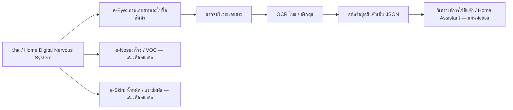

# ชุดเนื้อหาพร้อมทำ Assignment 5 — ความคืบหน้า e-Eye บน PC

> อัปเดตหลังตรวจการหมุนภาพ: ใช้ `ass5_output/Orientation_and_Language_Followup_2026-10-17.md` คู่กับผลนำร่องเดิม พบภาพตัวหนังสือหมุนข้าง 3/10 ในชุดตรวจแรกและ 6/6 ในชุดส่งเพิ่ม การทดสอบหมุนภาพเดิมแบบจับคู่พบ 7 ภาพอ่านตรง mAP@0.5 0.995 → 0.492 เมื่อหมุน 90° และ 6 ภาพส่งเพิ่ม 0.237 → 0.714 เมื่อหมุนให้อ่านตรงโดยไม่ฝึกเพิ่ม ส่วนสัดส่วนภาษา OCR ดิบยังไม่ผ่านการตรวจเฉลย จึงไม่ใช้เป็นตัวเลขผลวิจัย

อัปเดต 17 ตุลาคม 2569 ข้อมูลชุดนี้ต่อยอดจาก Assignment 4 ฉบับ PDF **32 หน้า** และ `handoff_thesis_unified_v10.md` โดยยึดคำแนะนำใน `ass 5ก่อนได้รับfeedback/คำแนะนำต่อ.docx` ร่วมกับอีเมลอาจารย์ล่าสุดที่ให้เริ่มจาก hardware virtualization ก่อนใช้บอร์ดจริง รอบนี้ยังไม่มีบอร์ด RK3588 จึงต้องแยก **ผลบน PC**, **ผลจาก RKNN SDK บน PC** และ **สิ่งที่ยังไม่ได้ทดสอบบน NPU จริง** ให้ชัด

## ข้อความแกนหลักสำหรับนำเสนอ

"โครงงานวางสถาปัตยกรรม e-Senses ของบ้าน โดยงานทดลองระยะแรกเจาะลึก e-Eye สำหรับภาพใบซื้อสินค้า เรารับภาพจริง 124 ไฟล์ เหลือภาพไม่ซ้ำระดับไฟล์ 113 ภาพ และได้ภาพผู้สมัครที่มีรายการซื้อสินค้า 59 ภาพ การทดลอง YOLOv8n บน PC ใช้ 48 ภาพ แบ่งฝึก 38 และตรวจ 10 ได้ mAP@0.5 = 0.928 ในชุดตรวจฉากเดิม แต่เมื่อทดสอบกับใบซื้อสินค้าใหม่ 6 ภาพที่ถ่ายต่างฉาก ค่า mAP@0.5 เหลือ 0.237 จึงเห็นข้อจำกัดด้านการถ่ายโอนผลชัดเจน เราแปลงโมเดลเป็น RKNN เป้าหมาย RK3588 และรัน inference ด้วย SDK บน PC ได้ ส่วนการสกัด JSON และประสิทธิภาพบน RK3588 NPU จริงยังเป็นงานถัดไป"

อย่าเรียก 59 ภาพว่า 59 ธุรกรรมอิสระ: บางภาพมีหลายเอกสาร บางคู่คล้ายกัน และ 48 ภาพของ YOLO ถูกเลือกตามนิยามเป้าหมายหนึ่ง `receipt_region` ต่อภาพ ชุดต่างฉาก 6 ภาพแยกจากการฝึกโดยสมบูรณ์ ยังไม่มีเฉลย OCR/JSON ที่มนุษย์ตรวจซ้ำครบพอจะรายงาน CER หรือ field accuracy ทั้งชุด

## สถาปัตยกรรมรวมที่คำแนะนำขอ

ขอบเขตที่ทดลองจริงตอนนี้คือ **ภาพจริง → คัดประเภท/EDA → ตรวจจับบริเวณเอกสารบน PC** และ **OCR spot-check 3 ภาพ** ส่วนกล้อง IP, LLM, MQTT, Home Assistant, burn-rate และ e-Nose/e-Skin เป็นสถาปัตยกรรม/แผน ยังไม่ใช่ผลทดลอง

## ตารางหลักฐานสำหรับสไลด์

| ขั้น | ผลที่ทำจริง | ข้อจำกัดที่ต้องพูดคู่กัน |
|---|---|---|
| รับข้อมูล | 124 JPG; SHA-256 ไม่ซ้ำ 113; ซ้ำตรงกัน 11; อ่านไม่ได้ 0 | จำนวนภาพ ไม่ใช่จำนวนธุรกรรม |
| คัดชนิดเอกสาร 113 ภาพ | ใบซื้อสินค้ามีรายการ 59; ใบรับเงิน 28; invoice ค่าหอ 14; อื่น 8; ใบส่งของ 2; ไม่ครบหน้า 1; รอตรวจละเอียด 1 | นับเฉพาะภาพไม่ซ้ำ; คัดโดยผู้ช่วยและยังควรตรวจซ้ำโดยผู้วิจัย |
| EDA ชุดใบซื้อสินค้า 59 ภาพ | พิมพ์ 41/เขียนมือ 18; แนวตั้ง 38/แนวนอน 21; brightness ทั้งภาพ median 173.9/255, ช่วง 109.7–185.9; contrast median 63.6/255; ความละเอียด 1.55–1.64 MP; ตัวหนังสืออ่านตรงเดิม 41/ต้องหมุน 90° อีก 18 | brightness/contrast วัดทั้งภาพรวมฉากหลัง; มุมเอียงย่อยอัตโนมัติวัดได้ 54 ภาพที่มีกรอบเดี่ยว แต่ยังไม่มีมุมเฉลยที่คนทำเครื่องหมายหรือสัดส่วนภาษาแท้จากข้อความที่ตรวจแล้ว; ดู `ass5_output/Orientation_and_Language_All_59_2026-10-17.md` |
| ตรวจมุมและภาษาในชุดประเมิน 16 ภาพ | หมุนข้าง 90° จำนวน 3/10 และ 6/6; มุมจัดแนวอัตโนมัติแบบค่าสัมบูรณ์มัธยฐานบนใบพิมพ์ 7 และ 6 ภาพคือ 1.00° และ 1.875°; ตรวจชื่อสินค้าที่อ่านได้ด้วยตาพบไทยปน Latin ชัด 10 ภาพ, ไทยโดยไม่เห็น Latin ชัด 5 ภาพ, ไม่ชัด 1 ภาพ | มุมย่อยไม่มีเฉลยจากคนและบางใบมีเส้นตารางหรือยับ; จำนวนภาพที่เห็นอักษรไม่ใช่สัดส่วนตัวอักษรจริง; ดูรายงาน `ass5_output/Orientation_and_Language_Followup_2026-10-17.md` |
| YOLOv8n receipt-region | ฝึก 38 / ตรวจ 10, CPU, 320 px; mAP@0.5 **0.928**, mAP@0.5:0.95 **0.687**, precision **0.883**, recall **0.758** | ชุดเล็ก ฉากถ่ายใกล้กัน; annotation ตรวจด้วยภาพโดยผู้ช่วย; ไม่ใช่ NPU benchmark |
| ตรวจ prediction ที่ confidence 0.25 | 10/10 ภาพมีอย่างน้อยหนึ่งกรอบ IoU≥0.5; predict call median **28.45 ms** จาก 30 ครั้งหลัง warm-up | มีหลายกรอบต่อภาพ (4–8) ต้องแก้ false positive/NMS; เวลาเป็น Windows PC CPU รวมอ่านไฟล์และ pre/postprocess |
| ชุดต่างฉากที่กันไว้ 6 ภาพ | ไม่ใช้ฝึก; mAP@0.5 **0.237**, mAP@0.5:0.95 **0.160**; กรอบที่ confidence สูงสุด IoU≥0.5 เพียง **1/6** ภาพ | เป็นภาพแนวนอนพื้น/แสงต่างจากชุดเดิม; label โดยผู้ช่วย; n เล็ก แต่ชี้ว่าผลฉากเดิมยังถ่ายโอนไม่ดี |
| EasyOCR ไทย+อังกฤษ | 3 ภาพ, 64–92 text regions/ภาพ, CPU ประมาณ 85–92 วินาที/ภาพ; spot-check ตัวเลขวันที่/ยอดรวมตรง 4 จาก 6 ช่อง | เป็นการจับคู่ช่องโดยคนแบบรอบเดียว; ยังไม่ใช่ระบบดึง field อัตโนมัติหรือ CER |
| JSON / LLM | มี schema และร่างเฉลยหนึ่งภาพที่รอตรวจซ้ำ | ยังไม่มีคะแนนความถูกต้องหรือการทดสอบ grammar/quantization |
| RKNN / NPU | export ONNX 12 MB; RKNN Toolkit2 v2.5.0 แปลงเป็น `.rknn` เป้าหมาย RK3588 แบบไม่ quantize; PC simulator รับภาพจริงและคืนผลขนาด `(1, 5, 2100)` ที่เป็น finite; เทียบ output กับ ONNX ได้ mean absolute difference 0.048 บน output ดิบ | ยังไม่มีความเร็ว พลังงาน RAM หรือความแม่นยำบน RK3588 NPU จริง; การเทียบ output ดิบไม่ใช่การรับรองความแม่นยำ end-to-end |

ภาพกราฟที่นำลงสไลด์ได้โดยไม่มีข้อมูลในใบเสร็จ: `ass5_assets/eda_itemized_59.png` ข้อมูลเชิงตัวเลขต้นทางอยู่ส่วนตัวที่ `C:\Users\NATCHAPOL\SeminarLab\reports\eda_itemized_59.json` ภาพใบเสร็จ กรอบ label รายภาพ และผล OCR ดิบเก็บเฉพาะ `C:\Users\NATCHAPOL\SeminarLab` นอก OneDrive

## โครงสไลด์ Ass5 ที่อัปเดตจากฉบับก่อน feedback

1. **ชื่อเรื่องและคำถามวิจัย** — ความคืบหน้า local e-Eye สำหรับข้อมูลห่วงโซ่อุปทานในบ้าน
2. **ภาพรวม e-Senses** — แผนภาพด้านบน: e-Eye / e-Nose / e-Skin แล้วไฮไลต์ว่าเลือก e-Eye มาศึกษา
3. **ปัญหาและขอบเขต** — ใบซื้อสินค้าไทย/อังกฤษหลายรูปแบบ; อธิบายว่า Ass4 เป็นฐานทบทวนวรรณกรรม ส่วน Ass5 เพิ่มหลักฐานทดลองเบื้องต้น
4. **Research gap และสมมติฐาน** — ความแม่นยำของ structured extraction ภายใต้ทรัพยากรจำกัด; อย่ากล่าวว่า “ยังไม่มีงานใด” หากไม่ได้พิสูจน์การค้นอย่างครอบคลุม
5. **ข้อมูลจริงและการคัดกรอง** — flow 124 → 113 → 59 → 48 (ฝึก/ตรวจฉากเดิม) + 6 (ชุดต่างฉาก) พร้อมเหตุผลของแต่ละขั้น; ใบค่าหออยู่ชุดเสริม
6. **EDA** — แสดงกราฟ `ass5_assets/eda_itemized_59.png` และระบุข้อจำกัด whole-image proxy
7. **วิธีทดลองเบื้องต้น** — นิยาม `receipt_region`, วิธีแบ่ง 38/10, YOLOv8n/CPU/320 px, metric; OCR สามภาพแยกจาก YOLO
8. **ผลและตัวอย่างข้อผิดพลาด** — เปรียบเทียบ mAP@0.5 **0.928 (ฉากเดิม, n=10)** กับ **0.237 (ต่างฉาก, n=6)**; บอก false positives และกรอบที่คะแนนสูงสุดจับทั้งภาพ; ใช้ภาพเอกสารเฉพาะเมื่อได้รับสิทธิและปกปิดข้อมูลส่วนตัว
9. **Hardware virtualization / deployment path** — PyTorch → ONNX → RKNN Toolkit2 v2.5.0 บน PC สำเร็จหนึ่งภาพ → board validation ภายหลัง; อย่าแปลงผล SDK เป็นค่า NPU latency
10. **สิ่งที่ยังต้องทำสำหรับ Ass6 และวิทยานิพนธ์** — เฉลยที่คนตรวจสองรอบ, เปรียบเทียบ OCR, JSON/LLM, ชุดทดสอบต่างฉาก, ทดสอบ SDK/บอร์ดเมื่อพร้อม

## ถ้อยคำที่ควรแก้จาก PPTX เดิม

- เปลี่ยน “ยังไม่รวมการทดลอง” เป็น “มีการทดลองนำร่องบน PC ด้านข้อมูล/YOLO/OCR; การจำลองด้วย SDK และทดสอบ NPU เป็นขั้นถัดไปตามสถานะจริง”
- เปลี่ยน “ระบบทำงานบน SBC เครื่องเดียว” เป็น “สถาปัตยกรรมเป้าหมายที่จะตรวจความเป็นไปได้”
- อย่าใส่ตาราง YOLOv10/v11, INT8 RKNN, FPS หรือ NPU 6 TOPS พร้อมค่า `XX` แล้วทำให้ดูเป็นผลทดลอง ผู้ทดลองรอบนี้มี YOLOv8n CPU เท่านั้น
- การเทรน YOLO ทำบน PC; NPU ของ RK3588 เป็นเป้าหมายการ deploy/inference ไม่ใช่หลักฐานว่าได้เทรนบน NPU
- หลีกเลี่ยงข้ออ้างว่า local AI เร็วกว่า cloud หรือประหยัดกว่าโดยไม่มีการเทียบจริง

## งานที่ยังต้องปิดก่อนอ้างผลวิจัยเต็มรูปแบบ

ผู้วิจัยควรตรวจประเภทเอกสารและกรอบ YOLO ซ้ำโดยไม่ดู prediction, จับกลุ่มธุรกรรม/เอกสารคู่ก่อนแบ่งชุดครั้งถัดไป, ทำเฉลยข้อความและ JSON ที่ตรวจซ้ำ และเพิ่มภาพถ่ายจากฉาก/อุปกรณ์/ร้านอื่นเพื่อแก้ปัญหา generalization ที่พบจริง. ผล PC-side RKNN ต้องรายงานแยกจากค่า NPU จริง แม้ conversion สำเร็จ
